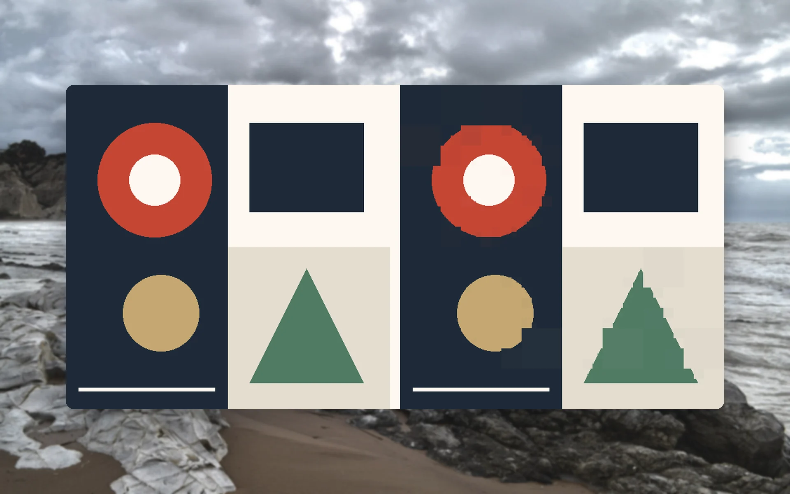
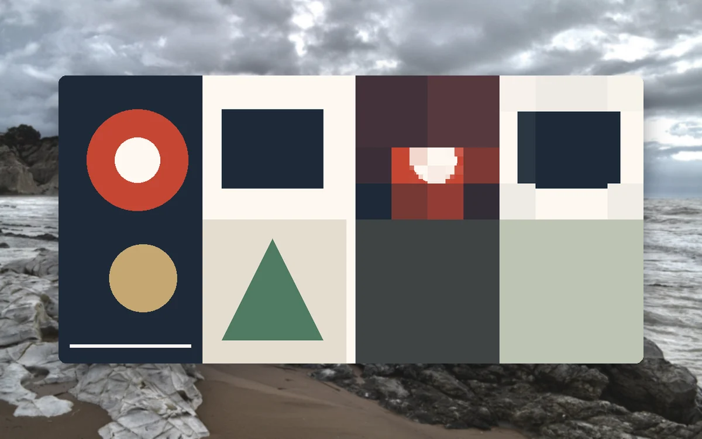
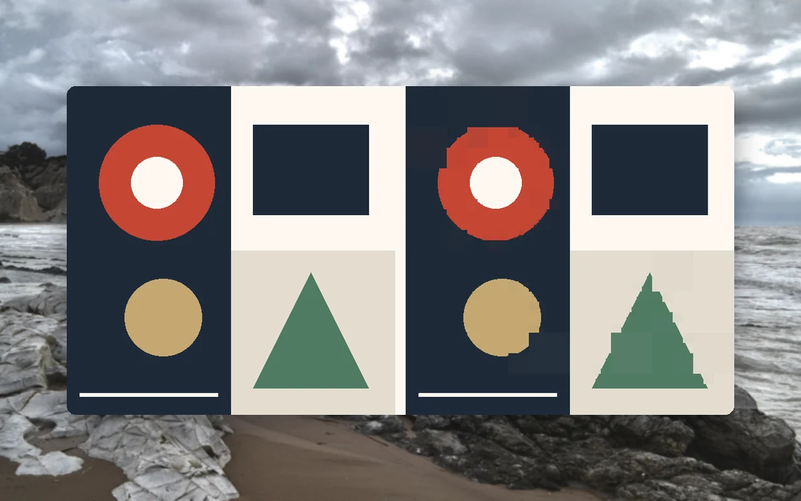
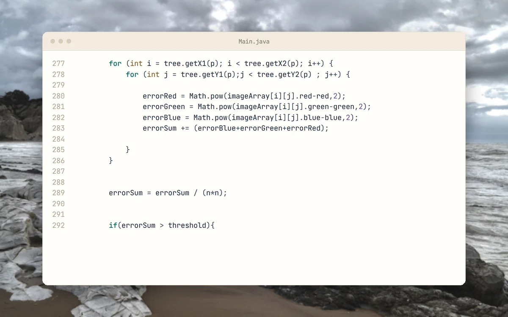

<p align="center">
  <picture>
    <source media="(prefers-color-scheme: dark)" srcset="docs/brand/svg/quadtree-compression-logo-on-dark.svg">
    
  </picture>
</p>

<h1 align="center">Split the image. Merge what looks alike.</h1>

<p align="center">
  Archived university coursework in Java, 2019.<br>
  <b>Square PPM images in. Eight levels of detail out.</b>
</p>

<p align="center">
  
  
  
  
  <a href="https://github.com/mertkayacs/Quadtree-Image-Compression"></a>
</p>

<p align="center">
  <a href="#quick-start"></a>
  <a href="Main.java"></a>
  <a href="https://mertkayacs.com/?utm_source=github&utm_medium=readme&utm_campaign=Quadtree-Image-Compression-repo&utm_content=portfolio-badge"></a>
</p>

<p align="center">
  <picture>
    <source media="(prefers-color-scheme: dark)" srcset="docs/assets/readme/hero-dark.webp">
    
  </picture>
</p>

Quadtree Image Compression reads a square PPM image, builds a quadtree from its pixels and writes eight versions of the image. Each version merges regions whose colours differ by less than a threshold, from large coarse blocks to the full-detail image. The tree is written by hand with no libraries. It was coursework from 2019.

---

## Why Quadtree Image Compression

A single run produces the whole range from coarse to fine.

|  |  |
|---|---|
|  **Eight thresholds per run** | [Main.java](Main.java) builds eight trees with thresholds from 14300 down to 0.000001 and writes the results as name-1.ppm to name-8.ppm, coarsest first. |
|  **A hand-written tree** | [QuadTree.java](QuadTree.java) is a tree ADT in which each node has 0 to 4 children. |
|  **Limits stated up front** | The original notes say it works best on images with high detail and colour differences, reads only PPM files and reads only square images. |

## A quick tour

<table>
  <tr>
    <td width="50%" valign="top">
      <picture>
        <source media="(prefers-color-scheme: dark)" srcset="docs/assets/readme/tour/coarse-dark.webp">
        
      </picture>
      <h3>Coarse level</h3>
      Level 2 of 8 merges regions into large blocks. The shapes are drawn for this tour.
    </td>
    <td width="50%" valign="top">
      <picture>
        <source media="(prefers-color-scheme: dark)" srcset="docs/assets/readme/tour/middle-dark.webp">
        
      </picture>
      <h3>Middle level</h3>
      Level 4 keeps the circle and the triangle recognisable, with visible block edges.
    </td>
  </tr>
  <tr>
    <td width="50%" valign="top">
      <picture>
        <source media="(prefers-color-scheme: dark)" srcset="docs/assets/readme/tour/fine-dark.webp">
        
      </picture>
      <h3>Fine level</h3>
      Level 6 is close to the input, with small blocks left along curved edges.
    </td>
    <td width="50%" valign="top">
      <picture>
        <source media="(prefers-color-scheme: dark)" srcset="docs/assets/readme/tour/split-dark.webp">
        
      </picture>
      <h3>Splitting rule</h3>
      A region is averaged, its error is measured, and it splits into four children when the error is above the threshold.
    </td>
  </tr>
</table>

<p align="center"><sub>Each image pair shows the test image on the left and one output level on the right. The test image was drawn for this tour. The code card shows Main.java as it is in the repository.</sub></p>

## Features

**Input and output**

- Reads square PPM images in the ASCII P3 format.
- Writes eight PPM files per run.

**Code**

- Main.java reads the image, builds the trees and writes the files.
- QuadTree.java, Position.java and Colour.java hold the tree and the colour values.

## Quick start

```sh
javac Colour.java Position.java QuadTree.java Main.java
java Main -i input.ppm -o out
```

The flags can come in either order. The run writes `out-1.ppm` to `out-8.ppm`. To make a P3 file from another image with ImageMagick:

```sh
convert photo.jpg -resize 512x512! -compress none input.ppm
```

### Requirements

- A Java JDK. The repository does not pin a version.
- ImageMagick, only to convert images to PPM.

## FAQ

<details>
<summary><b>Which images work?</b></summary>

Square PPM files in the ASCII P3 format. Other sizes and formats are not supported.
</details>

<details>
<summary><b>What do the eight outputs mean?</b></summary>

They use eight thresholds from coarse to fine. The first merges the most regions and the last keeps every pixel.
</details>

<details>
<summary><b>Do the outputs take less space?</b></summary>

No. The outputs are plain PPM files again, so they are about the same size as the input. The program shows what each quadtree approximation looks like and does not write a compact file.
</details>

If Quadtree Image Compression is useful to you, a ⭐ helps other people find it.

Photos behind the screenshots are credited in [docs/assets/readme/CREDITS.md](docs/assets/readme/CREDITS.md).

[](https://github.com/mertkayacs/Quadtree-Image-Compression)
